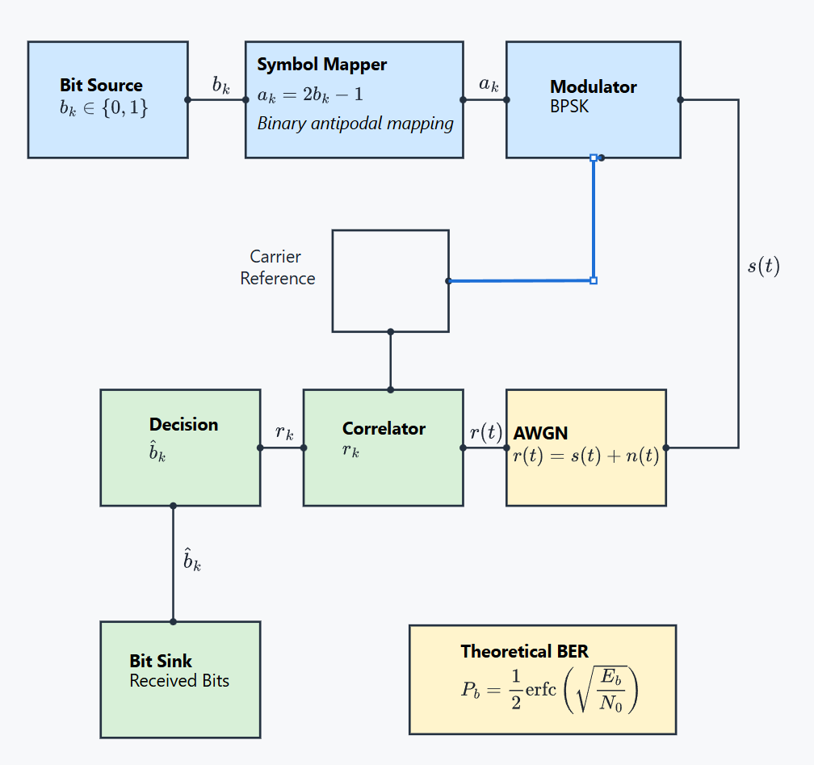

# A2 — BPSK coherent receiver demonstrator (application pilot)

**Status:** **Accepted** (28 Nov 2026) — second application pilot; first **end-to-end** kommtech system drawn with scientific labels (not an isolated feature test).  
**Baseline:** [A2-P1…P4 closed](diagram-lab-pilot-a2-p4-markdown-math.md); presentation track from [A1 closed](diagram-lab-pilot-a1-final-evaluation.md).  
**Related:** [A2 findings](diagram-lab-pilot-a2-findings.md), [A2 preparation](diagram-lab-pilot-a2-preparation.md), [P5 roadmap](diagram-lab-pilot-a2-p5-roadmap.md), [system figure](diagram-lab-demos/a2-bpsk-coherent-receiver.png).

---

## 1. User evaluation summary

| Criterion | Rating |
| --- | --- |
| System overview | Very good |
| Colour coding (TX / RX / channel) | Very good |
| Mathematical notation | Very good |
| Markdown + LaTeX mix | Very good |
| Signal labels on wires | Good |
| Wire routing | Good |
| Typography controls | Still limited (expected) |
| Obvious signal-flow direction | **P5b** metadata + **P5c** automatic arrowheads → [p5c doc](diagram-lab-pilot-a2-p5c-wire-arrowheads.md) |
| Symbol variety | Expandable → [P5d](diagram-lab-pilot-a2-p5-roadmap.md) |
| Suitability for scientific scriptum | Already good; clear upside |

The sheet reads like a **textbook figure**, not a bare editor prototype. Topology: simplified **coherent BPSK** with a shared carrier reference (idealised TX/RX synchronisation).

**Content erratum (reference captions, not editor defects):** BER block — use latin `b` subscripts (`P_b`, `E_b`) and `\operatorname{erfc}`:

```latex
P_b=\frac{1}{2}\operatorname{erfc}
\left(\sqrt{\frac{E_b}{N_0}}\right)
```

---

## 2. What this pilot validated

| Layer | Evidence |
| --- | --- |
| Symbol geometry + wires | Full multi-row BPSK flow with builtins + generics |
| Block appearance (P3) | Colour grouping by functional area |
| Scientific text | LaTeX block captions + Markdown wire labels ([P4](diagram-lab-pilot-a2-p4-markdown-math.md)) |
| Editor workflow | User-authored captions (practical usability, not fixture-only text) |
| Product direction | Same editor for HDL-Maker / Python-Lab / Webskriptum narrative |

Out of scope for this pilot: VHDL emit, Python execution, SVG export (D5e), reusable viewer (D5f).

---

## 3. Reference artefacts

| Artefact | Location | Notes |
| --- | --- | --- |
| **System reference figure** | [`diagram-lab-demos/a2-bpsk-coherent-receiver.png`](diagram-lab-demos/a2-bpsk-coherent-receiver.png) | Full-sheet BPSK diagram (TX blue, channel yellow, RX green, BER block) |
| P4 detail capture | [`diagram-lab-demos/a2-p4-markdown-math-demonstrator.png`](diagram-lab-demos/a2-p4-markdown-math-demonstrator.png) | Inspector + multiline wire label — [P4 §11](diagram-lab-pilot-a2-p4-markdown-math.md) |
| Diagram JSON (reload in Lab) | `docs/examples/a2-bpsk-coherent-receiver.diagram.json` | **Optional** — export from Lab when ready; pattern: [audio_gain_struct.diagram.json](examples/audio_gain_struct.diagram.json) |

Until the JSON is checked in, **`a2-bpsk-coherent-receiver.png`** is the canonical reference for layout and captions.



*Caption for papers:* Simplified coherent BPSK link with shared carrier reference, AWGN channel, and theoretical BER — drawn in Diagram-Lab with block appearance, LaTeX/Markdown display text, and wire labels.

---

## 4. Outcomes → roadmap (four packages)

Derived from demonstrator pain points — **spec + preflight only** until separate freigabe:

| ID | Topic | Priority after accept |
| --- | --- | --- |
| [A2-P5a](diagram-lab-pilot-a2-p5a-text-typography.md) | Text alignment + font size (plain / LaTeX / Markdown; block + wire) | **Closed** |
| [A2-P5b](diagram-lab-pilot-a2-p5b-port-direction.md) | Port `direction` metadata (not HDL semantics) | **Closed** |
| [A2-P5c](diagram-lab-pilot-a2-p5-roadmap.md#3-a2-p5c--wire-arrowheads) | Manual + automatic arrowheads from topology | Next |
| [A2-P5d](diagram-lab-pilot-a2-p5-roadmap.md#4-a2-p5d--generic-circle-block) | Circle primitive + guided ports | Next |

**Deferred (documented only):** bus width / parameterised widths, symbol designer, extra primitives, justified text, paragraph spacing, font family.

**Earlier “A2-P5”** (shared formatted-text extraction to symbol labels) remains optional; **P5a–P5d** supersede the numbering for the next implementation slices — see [roadmap §6](diagram-lab-pilot-a2-p5-roadmap.md#6-relation-to-legacy-a2-p5-label).

---

## 5. Pilot strategy contrast (A1 vs A2)

| A1 — Digital logic | A2 — Communications |
| --- | --- |
| Block colours | Scientific captions |
| Centre display text | LaTeX + Markdown |
| Name / port visibility | Symbol geometry (guides) |
| Grid & snap | Text typography (next) |
| Free label position | Signal-flow arrows (next) |
| Multi-label nets | Universal primitives (next) |

Both pilots pressure-test **one** Diagram-Lab editor without forking per product.

---

## 6. Handoff

1. ~~P5a / P5b~~ — **closed**. **P5c** — verify on BPSK with diagram default Automatic — [p5c](diagram-lab-pilot-a2-p5c-wire-arrowheads.md). Then **P5d**.  
2. Continue platform roadmap in parallel: **S5b**, **D5d**, **D5e**, **D5f** (unchanged gates).  
3. Optionally check in BPSK `.diagram.json` under `docs/examples/`.  
4. B2–B3 pilot diagrams when A2 follow-on packages stabilise.

No implementation in this document.