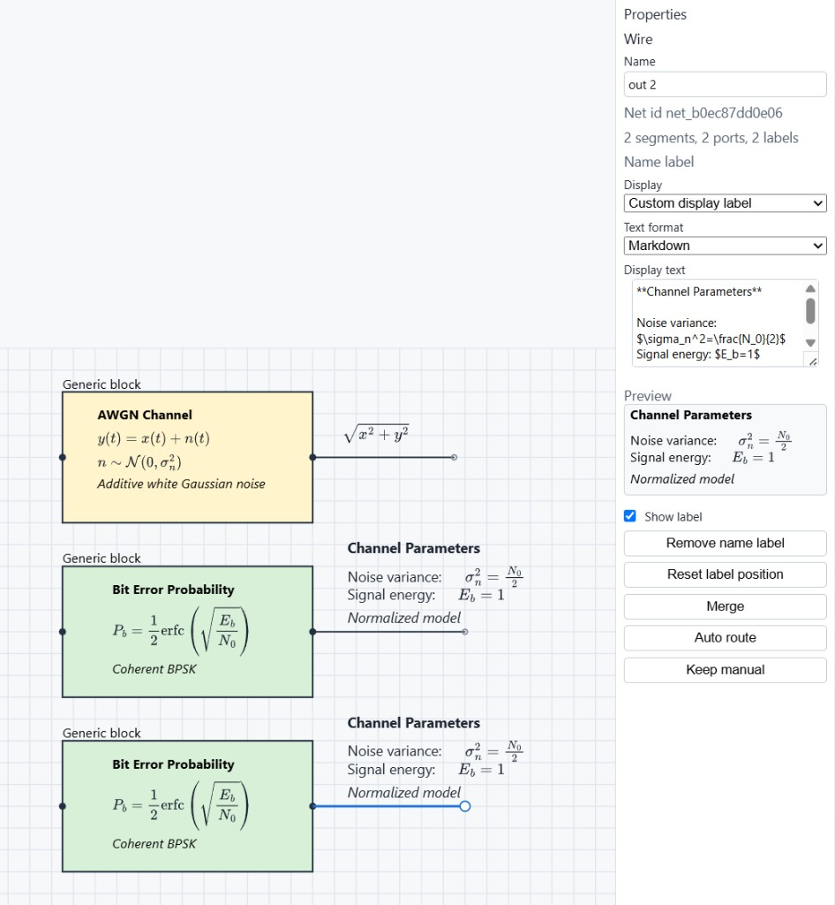

# A2-P4 — Markdown + inline math

**Status:** **Closed / accepted** (27 Nov 2026, visual aggregate acceptance).  
**Baseline:** [A2-P3](diagram-lab-pilot-a2-p3-latex-labels.md) + [A2-P3a](diagram-lab-pilot-a2-p3a-block-latex.md) closed; shared `mathRender.ts` + Fix1.  
**Related:** [scientific investigation](diagram-lab-pilot-a2-scientific-presentation-investigation.md) §5, [pilots](diagram-lab-application-pilots.md).  
**Gates:** S5b / D5d independent. D5e export not implemented in this package.

---

## 1. Objective

Add **`markdown`** as a third persisted text format for **wire display labels** and **block display text**, combining restricted prose styling with inline and display mathematics, while:

- Reusing **`mathRender`** (MathJax SVG) for all math — one cache, one security model.  
- Preferring **SVG-first layout** in the editor (align with D5e export goals).  
- Preserving **`plain`** and **`latex`** behaviour unchanged.

**Out of scope for P4 v1:** symbol-internal labels, free annotations, WYSIWYG rich-text editor, full CommonMark, HTML rendering in the canvas, D5e export, font-to-path conversion.

---

## 2. Consumer model

| Consumer | Persisted fields | P4 |
| --- | --- | --- |
| Wire name label | `displayText`, `textFormat?: plain \| latex \| markdown` | Markdown option + multiline textarea |
| Block caption | same | same |

```ts
textFormat?: 'plain' | 'latex' | 'markdown'  // omitted ≡ plain
```

- **Plain** and **LaTeX:** unchanged from P2/P3/P3a.  
- **Markdown:** source string only; layout + MathJax at runtime.

---

## 3. Supported subset (binding)

| Feature | Syntax |
| --- | --- |
| Line break | single newline outside math |
| Paragraph gap | blank line |
| Bold / italic / both | `**` / `*` / `***` |
| Inline code | `` ` `` — no math interpretation inside |
| Inline math | `$…$` |
| Display math | opening `$$` and closing `$$` each on its own line |
| Escaped `$` | `\$` |
| Malformed `$` | readable fallback + warning |
| HTML-like tags | literal text, no execution |

**Not in v1:** headings, lists, links, images, tables, `\(...\)` / `\[...\]`, autowrap, nested MD in math, executable HTML.

---

## 4. Architecture (approved)

**Approach B → SVG-first formatted text** (HTML hosts for block/wire chrome only):

```
Source (persisted)
  → formattedTextParse.ts (state-based tokenizer)
  → formattedTextRender.ts (layout + bbox, LRU by source+em)
  → mathRender.ts (unchanged, Fix1)
  → root <svg> + formatted-text group + nested MathJax <svg>
```

Consumers share one pipeline: wire label on canvas, block caption (`BlockNode.vue`), inspector previews (`DiagramStage.vue`).

**Layers (performance):**

| Layer | Invalidate on |
| --- | --- |
| Parse | source change |
| Layout | source, em, font metrics layout props |
| Presentation | colour (`currentColor`), position, visibility — no re-layout on pan/zoom/drag |

Display math line height follows tallest/deepest element per row; prose and inline math share a baseline per line.

**D5e boundary:** layout is SVG-friendly; normal prose uses `<text>` (font-dependent); MathJax uses paths. Future export may offer editable vs publication modes — not built in P4.

---

## 5. Binding decisions (§14 review, 27 Nov 2026)

1. Single `\n` = line break; blank line = paragraph gap; LaTeX newline semantics unchanged inside math delimiters.  
2. `$…$` inline; `$$` display on dedicated lines only; other delimiters deferred.  
3. Hand subset parser — no new npm dependency; no fragile global regex chains.  
4. No automatic wrapping or block resize from text width.  
5. Wire + block in one package (parser → layout → both consumers → previews → persistence tests).

---

## 6. Implementation map

| Module | Role |
| --- | --- |
| `diagram-lab/src/core/formattedTextParse.ts` | Parse tree |
| `diagram-lab/src/core/formattedTextRender.ts` | Layout + SVG fragment + layout LRU |
| `diagram-lab/src/core/mathRender.ts` | Math only (shared) |
| `diagram-lab/src/core/document.ts`, `nets.ts`, `edit.ts` | `markdown` on model + fragment paste |
| `diagram-lab/src/view/DiagramStage.vue` | Async maps, wire/block draw, inspector |
| `diagram-lab/src/view/BlockNode.vue` | Centre-aligned formatted host |
| `diagram-lab/src/style.css` | `.formatted`, preview host |

---

## 7. Automated verification

`npm run selfcheck` — `A2-P4:*` parser/persistence; **`A2-P4-Fix1:*`** (line breaks, paragraphs, root `<svg>`); **`A2-P4-Fix2:*`** (nested MathJax, fraction bar, sqrt, display `$$`).

`npm run check` — `vue-tsc --noEmit`.

**Browser/DOM:** validated by user acceptance (see §8, §11); not automated in CI.

### 7.1 A2-P4-Fix1 (layout + invisible prose)

**Root cause:** bare `<g>` + SVG `<text>` injected into HTML `<div>` hosts — no SVG namespace → concatenated lines. Fixed line stepping in `buildLayout`; full root `<svg>` wrapper; LaTeX-aligned placement.

### 7.2 A2-P4-Fix2 (invisible math)

**Root cause:** stripped MathJax `<svg>` + `scale(1,-1)` instead of full nested `<svg>` like A2-P3.

**Correction:** embed full MathJax output at `translate(x, baselineY)` with `rewriteSvgIds` only.

---

## 8. Manual acceptance checklist

Aggregate pass **accepted** (27 Nov 2026) — user visual sign-off covering block captions, wire labels, mixed prose/math, display equations (incl. BPSK BER / `erfc`), coloured blocks, zoom readability. Per-item mapping:

| # | Scenario | Sign-off |
| --- | --- | --- |
| 1 | AWGN-style caption (bold, inline math, italic) | Covered by demonstrator |
| 2 | BPSK / `cases` / decision logic | Covered by demonstrator |
| 3 | Low-pass / display `$$` + inline follow-up | Covered in regression + pilot sheet |
| 4 | BER / `erfc` display + italic caption | Covered by demonstrator |
| 5 | Markdown on wire (multiline scientific label) | **Confirmed** on wire in acceptance capture |
| 6 | Inspector preview ≈ canvas | Confirmed during Fix1/Fix2 retest |
| 7 | Undo, duplicate, fragment paste (`markdown`) | `selfcheck` persistence; not re-run item-by-item at accept |
| 8 | Plain + LaTeX regression | No regressions reported at accept |
| 9 | Zoom/pan without re-typeset flicker | Acceptable at reduced zoom |

**Progress:** 9 / 9 (aggregate visual acceptance).

---

## 9. Package status

| Package | State |
| --- | --- |
| A2-P3 / A2-P3a | Closed |
| A2-P4 | **Closed / accepted** |
| A2-P5 | Optional later (extract shared service, symbol labels) — not required for A2 pilot |
| D5e | Export boundary; next on product roadmap |

---

## 10. Handoff

**Immediate:** complete **BPSK demonstrator** (A2 application pilot) using Markdown captions and wire labels.

**Roadmap (unchanged gates):** S5b → D5d (performance) → **D5e** (SVG export, publication vectors) → **D5f** (reusable Vue surface). P4 layout + `mathRender` is the bridge toward Webskriptum-style scientific figures.

Object Snap remains deferred. No commit/push from this close-out unless separately requested.

---

## 11. Demonstrator figure (publication-ready)

User acceptance screenshot — scientific labels on blocks **and** wires, mixed Markdown + math (incl. nested fractions, roots, automatic delimiter sizing).



*Caption suggestion for papers:* “Diagram-Lab A2-P4: restricted Markdown with inline and display MathJax SVG on block display text and wire name labels; shared layout pipeline (`formattedTextParse` / `formattedTextRender` / `mathRender`).”

Copy the accepted PNG into [`diagram-lab-demos/a2-p4-markdown-math-demonstrator.png`](diagram-lab-demos/a2-p4-markdown-math-demonstrator.png) when committing documentation assets (see [demos README](diagram-lab-demos/README.md)).

---

## 12. Deferred enhancements (not acceptance blockers)

Recorded for future packages only — **do not implement** without separate freigabe:

- Text alignment (left / centre / right).  
- Per-label font size and line/paragraph spacing.  
- Mixed font sizes within one Markdown field.  
- Standalone scientific text objects (not tied to block or wire).